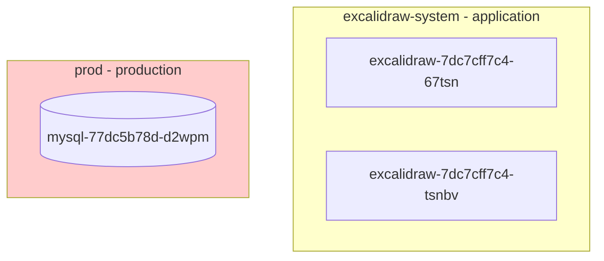

# Ground Truth Architecture Generator

## What It Does

The `architecture_generator.py` script analyzes your K8s runtime data and produces a **ground truth architecture diagram** showing:

- **Trust boundaries** (namespaces) with color-coded environments (prod=red, dev=green, system=blue)
- **Pods** with their security contexts
- **Services** and their backend pods
- **Communication flows** (intra-namespace, cross-namespace, external)
- **Security issues** highlighted (hostPID, hostNetwork, etc.)

This is useful for your paper to show the **actual system architecture** versus what you expect.

---

## Usage

### Step 1: Generate Architecture

```bash
python k8s_threat_model/architecture_generator.py
```

This creates:
- `tm/ground_truth_architecture.txt` - **Text representation for LLM input**
- `tm/ground_truth_architecture_mermaid.md` - **Mermaid diagram for GitHub/docs**
- `tm/ground_truth_architecture.dot` - **Graphviz source**
- `tm/ground_truth_architecture.json` - **Structured data**
- `tm/ground_truth_architecture.png` - **Visual diagram (if Graphviz installed)**

---

## Output Files

### 1. Text Representation (for LLM)

**File**: `tm/ground_truth_architecture.txt`

This is a human-readable description of your architecture that you can paste into an LLM prompt:

```
# GROUND TRUTH KUBERNETES ARCHITECTURE
========================================

## Summary
- Total Namespaces: 2
- Total Pods: 3
- Total Services: 2

## Trust Boundaries (Namespaces)

### excalidraw-system [APPLICATION]
  Pods: 2
  - excalidraw-7dc7cff7c4-67tsn
    ServiceAccount: default
    Containers: excalidraw/excalidraw:latest

### prod [PRODUCTION]
  Pods: 1
  - mysql-77dc5b78d-d2wpm
    ServiceAccount: default
    Containers: mysql:8.0

## Services
...
```

**Usage**:
```
Copy the contents and prompt your LLM:
"Here is my Kubernetes architecture. Analyze it for security risks:
[paste tm/ground_truth_architecture.txt]"
```

---

### 2. Mermaid Diagram (for Documentation)

**File**: `tm/ground_truth_architecture_mermaid.md`

A Mermaid diagram that renders in GitHub, Notion, Obsidian, etc:



**Usage**: Include in your paper's appendix or GitHub README

---

### 3. Graphviz DOT (for High-Quality Diagrams)

**File**: `tm/ground_truth_architecture.dot`

Graphviz source that can be rendered to PNG, SVG, PDF:

```dot
digraph K8sArchitecture {
    rankdir=LR;
    subgraph cluster_excalidraw_system {
        label="excalidraw-system\n[APPLICATION]";
        "excalidraw-7dc7cff7c4-67tsn" [shape=box, fillcolor="#90ee90"];
        ...
    }
}
```

**Rendering**:

#### Option 1: Install Graphviz Locally

**Windows**:
```bash
choco install graphviz
# OR download from https://graphviz.org/download/
```

**Linux**:
```bash
sudo apt-get install graphviz
```

**Mac**:
```bash
brew install graphviz
```

Then render:
```bash
dot -Tpng tm/ground_truth_architecture.dot -o tm/ground_truth_architecture.png
```

#### Option 2: Online Rendering

1. Go to https://dreampuf.github.io/GraphvizOnline/
2. Copy contents of `tm/ground_truth_architecture.dot`
3. Paste and download PNG

#### Option 3: VSCode Extension

Install "Graphviz Preview" extension in VSCode, then open `.dot` file and click "Preview"

---

### 4. Structured JSON (for Programmatic Access)

**File**: `tm/ground_truth_architecture.json`

Structured data for scripts/tools:

```json
{
  "namespaces": {
    "excalidraw-system": ["excalidraw-7dc7cff7c4-67tsn", ...],
    "prod": ["mysql-77dc5b78d-d2wpm"]
  },
  "pods": {
    "excalidraw-7dc7cff7c4-67tsn": {
      "namespace": "excalidraw-system",
      "serviceAccount": "default",
      ...
    }
  },
  ...
}
```

**Usage**: Import into Python scripts for analysis

---

## Understanding the Diagram

### Trust Boundaries (Colors)

- **Red** (`#ffcccc`): Production environments
- **Green** (`#ccffcc`): Development/test environments
- **Blue** (`#ccccff`): System namespaces (kube-system, etc.)
- **Yellow** (`#ffffcc`): Application namespaces

### Pod Shapes

- **Rectangle**: Regular processes/applications
- **Cylinder**: Databases (MySQL, PostgreSQL, etc.)
- **Cloud**: External entities (Internet)

### Communication Arrows

- **Solid green arrow** `-->`: Intra-namespace (same trust boundary)
- **Dashed red arrow** `-..->`: Cross-namespace (trust boundary violation)
- **Thick orange arrow** `==>`: External egress (to Internet)

### Security Markers

- **⚠️ Icon**: Pod has security issues (hostPID, hostNetwork, etc.)

---

## Example: Using with LLM for Threat Analysis

### Prompt Template

```
I have a Kubernetes cluster with the following architecture:

[PASTE tm/ground_truth_architecture.txt HERE]

Please analyze this architecture for:
1. Trust boundary violations
2. Over-privileged service accounts
3. Missing network segmentation
4. Potential lateral movement paths
5. Data flow risks (especially dev accessing prod)

Provide a prioritized list of security issues.
```

### Expected LLM Output

```
Security Analysis:

1. CRITICAL: No network segmentation between dev and prod
   - excalidraw-system (application) and prod namespaces have no NetworkPolicies
   - Potential lateral movement: app pods could access mysql database

2. HIGH: Missing authentication on mysql service
   - Service exposed on 10.43.175.202:3306 without authentication visible
   - Recommend: Use mutual TLS, secrets management

3. MEDIUM: Default service accounts
   - All pods use 'default' service account
   - Recommend: Create dedicated service accounts with least privilege
...
```

---

## For Your Paper

### Figure: Ground Truth Architecture

Include `tm/ground_truth_architecture.png` in your paper with caption:

```
Figure X: Ground Truth Kubernetes Architecture
Shows the actual deployed architecture with trust boundaries (namespaces),
pods, and communication flows captured via runtime monitoring.
```

## Comparison with DFD

| Feature | DFD (model.py) | Ground Truth Architecture |
|---------|----------------|---------------------------|
| **Source** | PyTM threat model | Direct K8s runtime data |
| **Purpose** | STRIDE threat generation | Architecture documentation |
| **Granularity** | Dataflows + threats | Pods + namespaces + services |
| **Use Case** | Automated threat analysis | Human understanding + LLM input |
| **For Paper** | Shows STRIDE results | Shows actual system |

**Recommendation**: Use both!
- Ground truth architecture → Shows what you're analyzing
- DFD → Shows threats found

---

## Updating the Diagram

The architecture is generated from `tm/k8s_enhanced_metadata.json`, so to update:

```bash
# 1. Collect fresh runtime data
python k8s_extractor/main.py

# 2. Regenerate architecture
python k8s_threat_model/architecture_generator.py

# 3. (Optional) Render PNG if you have Graphviz
dot -Tpng tm/ground_truth_architecture.dot -o tm/ground_truth_architecture.png
```

---

## Integration with Threat Modeling Pipeline

You can integrate this into your workflow:

**Updated `create-diagrams.sh`**:
```bash
#!/bin/bash

# Collect K8s data
python k8s_extractor/main.py

# Generate ground truth architecture
python k8s_threat_model/architecture_generator.py

# Generate threat model
python k8s_threat_model/main.py

# Generate diagrams
python model.py --dfd | dot -Tpng -o tm/dfd.png
python model.py --seq | java -Djava.awt.headless=true -jar plantuml.jar -tpng -pipe > tm/seq.png
python model.py --report docs/basic_template.md | pandoc -f markdown -t html > tm/report.html

echo "✅ Complete pipeline executed"
```

---

## Troubleshooting

### No Communication Flows Detected

**Symptom**: `Communication Flows: 0` in output

**Cause**: Hubble flows don't match pod names

**Fix**: Check if Hubble is capturing flows:
```bash
hubble observe --last 100 | grep -i "pod"
```

### Graphviz Not Rendering

**Symptom**: `⚠️ Graphviz not found`

**Fix**:
1. Install Graphviz (see "Rendering" section above)
2. OR use online renderer at https://dreampuf.github.io/GraphvizOnline/

### Missing Pods

**Symptom**: Expected pods not in diagram

**Cause**: `namespace_utils.py` filters to user namespaces only

**Fix**: Check `k8s_extractor/namespace_utils.py` filter logic

---

## Questions?

For implementation details, see:
- `k8s_threat_model/architecture_generator.py` - Source code
- `tm/ground_truth_architecture.json` - Raw architecture data
- `FRAMEWORK_IMPROVEMENTS.md` - Overall framework docs
